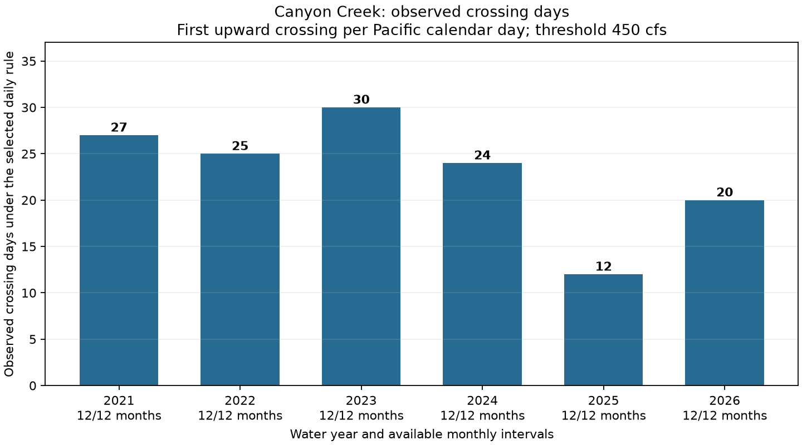
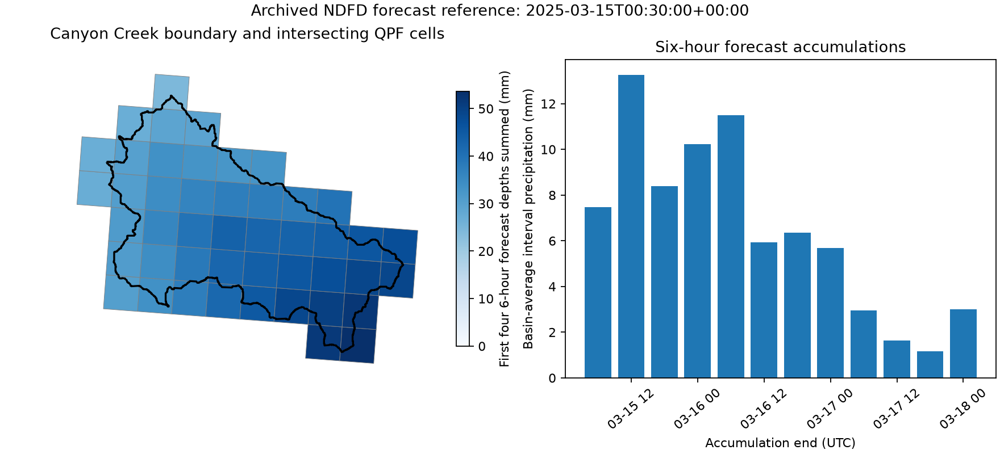

# Canyon Creek streamflow forecasting — Phase 1 data feasibility

Verified October 25, 2026. USGS station **14219000, Canyon Creek near Amboy, Washington**.
No predictive model has been implemented or trained.

The subsequent [2025 paired-data pilot](pilot_2025.md) is now complete: twelve diagnostic
rows join actual basin QPF, antecedent streamflow and the crossing target. That report records
the explicit timing assumptions, quality/leakage checks, missing QPF horizon and measured costs.

## Recommendation and current status

**Proceed to construction of a historical dataset using actual operational NDFD precipitation
forecasts.** Public downloads, GRIB metadata, watershed extraction and streamflow-target feasibility
have been demonstrated. Six complete water-year counting periods, **2021–2026** (October 2020–
September 2026), have now been audited for streamflow and daily forecast-object availability.

The observed record contains **138 crossing days** under the selected first-crossing-per-local-day
rule. Annual observed counts are **27, 25, 30, 24, 12 and 20**. That is a credible starting point
for an initial modest model study, subject to the remaining data-construction checks below. It is
not evidence of predictive skill or 138 independent storms. A chronological 2021–2024 / 2025–2026
split would contain 106 / 32 observed crossing days before any additional feature-quality exclusions.

**Ten years of usable archived forecasts remain unverified.** AWS begins April 16, 2020. NCEI
provided an actual June 2018 file, but its older archive needs a separate completeness/delivery
test. Prefer the verified AWS-era period first; do not assume that 2018–present is a complete,
interchangeable archive merely because individual older files exist.

Data access recovered and the six-year audit finished. Earlier cloud gateway failures were real
and are preserved in diagnostic evidence, but they no longer block this completed audit. A USGS
key is not visible/bound in the current shell, so successful requests are not claimed as verified
keyed authentication. Optional `USGS_API_KEY` support is implemented; credentials belong in the
secure value field under that name, followed by saving/publishing the environment configuration.
No credential values are recorded in this report or scripts.

## Target definition and actual streamflow results

Evaluate while observed discharge is **strictly below 450 cfs**. The target is a subsequent
observed upward crossing to **strictly above 450 cfs within (t, t + 72 hours]**. Equality at 450
preserves the previous below/above state and does not itself create an event. Retain only the
first crossing on each **America/Los_Angeles calendar date**. Store timestamps in UTC.
Missing observations reset crossing state; no crossing is inferred across a gap. The rule
suppresses same-day oscillations, while related crossings on successive days can remain.

| Water year | Observations / expected 15-min slots | Raw crossings | Retained days | Conservatively eligible hourly decisions | Positive decisions |
| --- | ---: | ---: | ---: | ---: | ---: |
| 2021 | 35,037 / 35,040 | 80 | **27** | 6,520 | 657 |
| 2022 | 35,037 / 35,040 | 50 | **25** | 5,119 | 670 |
| 2023 | 35,011 / 35,040 | 81 | **30** | 6,339 | 879 |
| 2024 | 33,295 / 35,136 | 58 | **24** | 5,356 | 745 |
| 2025 | 35,033 / 35,040 | 15 | **12** | 6,401 | 504 |
| 2026 | 34,218 / 35,040 | 29 | **20** | 5,727 | 756 |
| **Total** | **207,631 / 210,336** | **313** | **138** | **35,462** | **4,211** |

Eligibility above requires flow below 450 at the decision time, a complete observed next 72 hours,
and complete earlier observation history on the current local day. The last requirement prevents
an earlier unobserved crossing from making a later crossing look like that day's first. Initial
partial local days are excluded. Monthly endpoints are deduplicated only if their full rows agree;
conflicting observations fail explicitly. A small trailing buffer supports decisions at year end.

The crossing-day count remains observed evidence even where exact first-crossing timing is uncertain.
In particular, March 4, 2026 has gaps and an observed crossing; ambiguous target examples are masked.
This conservative screen supplies **4,211 positive and 31,251 negative hourly decisions**, about
**11.87% positive** in this cleaned subset. Windows overlap heavily. This is not 35,462 independent
training samples, and an always-negative baseline would already have about 88% accuracy.
Antecedent feature windows will need their own coverage masks during dataset construction.



### Station record, cadence and quality

The USGS metadata identify primary instantaneous discharge series
`bc30bb0c2bcb4d189cc32d707936740d`, beginning **2006-11-01 08:00 UTC**. The older daily-mean
record begins in 1922; it is not a century-long instantaneous record. The 31 returned annual
peaks cover water years 1923–1934 and 2007–2025, all above 450 cfs, but annual maxima cannot
measure crossing frequency. The initial daily-mean screening underestimated crossings: for
example, water year 2025 had eight daily-mean upcrossings versus twelve instantaneous crossing days.

The six-year record fills **98.71% of expected quarter-hour slots**, with **2,705 slots not returned**.
These are not all the same kind of absence:

- Water years 2021, 2022 and 2025 each have a few short gaps.
- In 2024, parts of July/August have much coarser, estimated observations, including four-hour
  intervals. These are not silently interpolated into 15-minute data.
- In 2026, a long gap runs from July 28 18:00 UTC to August 5 21:00 UTC, alongside shorter gaps.
- There is one estimated value in the 2023 period and 126 in 2024. Censoring estimated values
  leaves their observed crossing-day counts unchanged (30 and 24); other target-quality effects
  should still be checked. Qualifiers can be strings, lists or null and are explicitly preserved.
- Within the 2026 counting period, 8,682 returned observations are provisional and may be revised.
  All **138 retained crossing observations** carry approved status. Future revisions should be
  tracked using retained response/CSV hashes rather than silently replacing a frozen dataset.

The gaps can hide additional events. Counts describe observed crossings at the source sampling
resolution, not continuous-time flood counts. First-above timestamps also have nominal quarter-hour
resolution. Keep provisional/estimated flags, distinguish sparse periods from zeros, and do not
turn incomplete future coverage into negative targets.

Exact URLs, response hashes, merged CSV hashes, gap timestamps, quality counts and events are in
`docs/feasibility_evidence/water_year_*_flow.json`. Raw responses and merged CSVs are retained in
ignored `.cache/feasibility/`, not bulk-committed into the repository.

## Historical precipitation forecasts

### Verified sources and historical extent

| Source | Verified access | Historical conclusion |
| --- | --- | --- |
| NOAA NDFD AWS public archive | Anonymous S3 listings and actual GRIB2 downloads; all 2,191 date folders in water years 2021–2026 inventoried | Best verified source for April 2020 onward; ten years not available here |
| NCEI NDFD THREDDS | Actual June 1, 2018 CONUS QPF downloaded and decoded | Older extension is promising, but continuity is unverified |
| NCEI AIRS | Live order form and advertised historical coverage inspected; no order submitted | Product documentation says June 2004 onward; the QPF-related YIU selection advertises July 2008 onward, not proof of delivered complete QPF |
| Northwest RFC | Live site exposes six-hour/24-hour gridded forecast precipitation controls | No historical gridded RFC QPF file validated |
| WPC | Tested QPF page returned HTTP 403 | No usable historical archive established |
| GFS/GEFS AWS | Historical November 2021 prefixes listed | Alternative leads only; no precipitation grid downloaded/decoded for them |

Official documentation actually retrieved:

- [NCEI NDFD product page](https://www.ncei.noaa.gov/products/weather-climate-models/national-digital-forecast-database).
- [AWS registry metadata](https://raw.githubusercontent.com/awslabs/open-data-registry/main/datasets/noaa-ndfd.yaml).
- [NCEI NDFD catalog](https://www.ncei.noaa.gov/thredds/model/ndfd.html).
- [NCEI AIRS order form](https://www.ncei.noaa.gov/has/HAS.FileAppRouter?datasetname=9959_02&subqueryby=STATION&applname=&outdest=FILE).

The AWS registry describes forecasts prepared by NWS offices and combined into an operational
mosaic. NCEI catalog metadata explicitly say products are archived in operational state, excluding
experimental products. Decoded samples are accumulated forecasts (`typeOfProcessedData=fc`),
not retrospective precipitation analyses. Observations/reanalysis must not substitute for future
QPF in an operational hindcast; that would leak future weather.

### Actual historical files downloaded and decoded

AWS base URL: `https://noaa-ndfd-pds.s3.amazonaws.com/`.

| Date | Exact key or NCEI URL |
| --- | --- |
| 2018-06-01 | `https://www.ncei.noaa.gov/thredds/fileServer/model-ndfd-file_kwbn-old/201806/20180601/YIUZ98_KWBN_201806010115` |
| 2020-04-16 | `wmo/qpf/2020/04/16/YIUZ98_KWBN_202004161548` |
| 2021-11-14 | `wmo/qpf/2021/11/14/YIUZ98_KWBN_202111140019` |
| 2022-12-26 | `wmo/qpf/2022/12/26/YIUZ98_KWBN_202212260025` |
| 2023-12-04 | `wmo/qpf/2023/12/04/YIUZ98_KWBN_202312040017` |
| 2024-01-27 | `wmo/qpf/2024/01/27/YIUZ98_KWBN_202401270020` |
| 2024-11-15 | `wmo/qpf/2024/11/15/YIUZ98_KWBN_202411150016` |
| 2025-01-15 | `wmo/qpf/2025/01/15/YIUZ98_KWBN_202501150016` |
| 2025-03-15 | `wmo/qpf/2025/03/15/YIUZ98_KWBN_202503150016` |
| 2025-07-15 | `wmo/qpf/2025/07/15/YIUZ98_KWBN_202507150016` |

These ten unique CONUS files total approximately 50 MB; exploratory other-domain files and repeat
validation requests are separate. No full historical gridded dataset was acquired. Each selected
CONUS file has twelve six-hour accumulation messages on a **2145 × 1377 Lambert conformal grid**,
spacing **2539.703 m**, with total precipitation identified by discipline 0/category 1/parameter 8.
The November 2021 window was chosen as a wet-event candidate; USGS independently showed discharge
up to 7,330 cfs in that window. No observed basin rainfall total or meteorological attribution is claimed.

### Times and forecast availability

Original bulletin filenames, GRIB reference times, valid interval ends and six-hour durations are
preserved. They differ: `...202111140019` has filename time **00:19 UTC**, GRIB reference time
**00:30 UTC**, and first accumulation **00:00–06:00 UTC**. Its last interval ends November 17
at 00:00 UTC, only **71.5 hours after reference time**. Some sampled issues have a shorter
remaining horizon. A 72-hour streamflow target is feasible, but full +72-hour weather coverage
must not be assumed. Retain actual interval bounds, elapsed fractions, forecast age and missing-lead
indicators; do not fabricate hourly precipitation from six-hour totals.

Actual operational delivery latency has **not** been established by archive inventory. Neither
valid time, folder date nor S3 LastModified alone proves that a forecast was available by a historical
decision time. An explicit conservative as-of rule is a remaining requirement before a training set.
The script retains raw GRIB time-unit keys because ecCodes step accessors can round/mix minute-valued leads.

### Six-year inventory and inconsistent conventions

All **2,191** daily folders in October 2020–September 2026 contain canonical CONUS bulletins.
After filtering, the inventory has **104,487 bulletin objects / 104,480 unique bulletin filenames**.
Seven bulletin names recur under later date folders; byte-level equality is unverified, so compare
content/GRIB metadata before merging versions. Folder date is not an issuance timestamp.

**Seventeen `.aux.xml` metadata sidecars were excluded**, not counted as forecasts. Canonical
bulletin names must match the WMO/center/twelve-digit timestamp convention with no extension.
Ignored keys remain recorded for provenance. Initial unfiltered counts were corrected from cache.

There are **135 missing filename-hour bins** across 52,584 expected hourly bins. This does not
measure actual delivery uptime or imply that NOAA promises exactly 48 issues/day. The longest
observed interval between consecutive bulletin filename timestamps is **16.97 hours**,
from **2022-12-16T22:22:00+00:00** to **2022-12-17T15:20:00+00:00**. A stale-forecast policy is therefore needed.
This date-level audit is substantially stronger than a few samples, but all 104,487 object contents,
lead intervals and watershed missing masks have not been exhaustively decoded.

Per-year counts, exact listing URLs, repeated names, ignored sidecars and missing-hour dates are in
`docs/feasibility_evidence/water_year_*_inventory.json`; full object listings remain cached locally.
The canonical combined status is `docs/feasibility_evidence/multiyear_audit_status.json`.

### NCEI limitations and the ten-year goal

The inspected direct NCEI old catalog starts in June 2018. AIRS lists earlier data and requests
email/delivery information, but a bounded pre-2018 QPF order has not been submitted or delivered.
Test a 2015/2016 YIU day before assuming a ten-year dataset. An advertised product-wide start
in 2004 does not establish the same QPF grid, lead range or complete cycles throughout that period.

NCEI is not a proven complete mirror of AWS. Its March 15, 2025 catalog listed only 15 matching
CONUS files versus 48 on AWS. Testing an actual listed NCSS subset-metadata endpoint returned
HTTP 500 with a backend S3 403. No basin subset was downloaded or validated through NCSS.
Exact failed URLs and status are preserved in `ncei_subset_probe.json`. This does not invalidate
the successful June 2018 direct download, but rules out claiming that the subset route works.

The best verified fallback if older delivery fails is a shorter **actual-forecast** dataset with
explicit coverage masks and recent-year evaluation. It has fewer independent winters and uncertain
rare-storm calibration. More old data can add event diversity while introducing older forecast-error
regimes; it is not automatically better.

## Watershed extraction verified

Use the repository boundary **`Basins/Canyon_Creek_WA/basin.geojson`**, identified by the user.
It is one valid nonempty EPSG:4326 polygon. Area is **167.34 km² / 64.61 square miles**, versus
USGS's **64.1 square miles**, about 0.8% different. The actual gage location
(**45.9398339, -122.3170398**) lies inside it; the configured delineation point differs slightly.
This supports feasibility use while retaining the outlet/area discrepancy as a caveat.

The tested extractor:

1. Decodes NDFD using NOAA-recommended **grib2io 2.8.2 / NCEPLIBS-g2c 2.3.0** and checks values
   independently against ecCodes.
2. Constructs native spherical-Lambert cell footprints using the GRIB earth shape and grid spacing;
   densifies edges; projects footprints/basin to EPSG:5070 for intersection areas.
3. Uses fractional weights `area(cell intersection basin)`, including boundary cells, rather than
   a point sample or center-only mask. Cache weights by boundary/grid identity in a future pipeline.
4. Calculates `sum(weight * depth) / sum(valid weight)` with a separately reported valid-area
   fraction and a 99% minimum. Missing depth is not zero; inadequate coverage fails explicitly.
5. Keeps reference time and accumulation interval separate, summing only disjoint intervals with
   confirmed units. A constant 7 mm field returns 7 mm, and weights cover the full basin numerically.

**46 cells** intersect this basin. Four actual forecasts (November 2024, January/March/July 2025)
were checked across all twelve fields: complete basin coverage and maximum decoder discrepancy
about **0.00000336 mm**. grib2io confirms units **kg/m²**, equivalent to mm water depth; ecCodes
alone reports unknown names/units for these files.

The **alternating-row scan correction matters**: raw ecCodes odd rows must be reversed before
comparison with grib2io's canonical grid. Without correction, the first tested field differed by
more than 20 mm at some cells. The corrected full-field values and missing masks agree.

For the March 15, 2025 00:30 UTC issue, the first four six-hour basin depths sum to **39.36 mm
(about 1.55 inches)**. This is forecast precipitation, not measured rainfall. The observed upward
crossing was at 09:30 UTC. That ordering demonstrates a usable source pairing, not forecast skill.



GeoPandas/Shapely/pyproj support the geometry work; NumPy/xarray support labeled data. Rasterio
plus exactextract is another option after verifying grid orientation and affine transforms, but
is not required by these scripts. The small native build used here supports sampled complex
packing; PNG/JPEG/AEC packing and interpolation need their supported dependencies if encountered.
Initializing pyproj before ecCodes avoids an observed native PROJ-library conflict in this environment.

## Reproduce the checks

Run from the repository root. Current cloud Python is `/workspace/venvs/watershed/bin/python`.
For a fresh local environment:

```bash
python3.11 -m venv .cache/feasibility-venv
source .cache/feasibility-venv/bin/activate
python -m pip install -r requirements.txt
```

Small live probes and the bounded year-level audit:

```bash
python -B scripts/test_usgs.py
python -B scripts/test_qpf_archive.py
python -B scripts/audit_multiyear.py
```

The last command audits 2021–2026, caps new flow responses at 160 MiB, uses monthly requests
with an 8 MB response limit and rejects paginated incomplete samples. Each year is limited to
40 MiB of response data. S3 inventory uses at most three connections, narrow prefixes and cached
pages, and stops after repeated network errors. It downloads **no forecast grids**. Initial gateway
failures are diagnostic history; completed cached reruns now return success.

Offline reproduction with the retained cache, including zero-new-transfer verification:

```bash
python -B scripts/audit_multiyear.py --cached-only
python -B scripts/audit_cached_flow.py
python -B scripts/plot_available_flow.py
python -B -m unittest discover -s scripts -p 'test_*.py' -v
```

All six year-level audits were rerun from cache successfully. **Twenty-four regression tests pass**,
including strict crossings/equality, daily deduplication, daylight-saving transitions, gaps,
pre-decision local-day history, year-end future support, duplicate endpoint conflicts, qualifier
lists, API-key scoping, download limits, S3 sidecars and network circuit breaking.

Independent basin extraction is optional native setup:

```bash
bash scripts/setup_grib2io.sh
python -B scripts/probe_basin_qpf.py --file .cache/feasibility/qpf/8b6021fe16c72b83536489ed454ce95344ec92bba9f3090dc3492e9346bbf929.grib2
```

Use the path reported by the QPF downloader if a different output directory was chosen.
`requirements-basin.txt` declares grib2io; the helper first builds the pinned g2c source commit
`acbccb8a894255cd30056b722781a7c9f7b1fe3c` with two workers into an ignored local cache.
The current cloud native build is retained at `/workspace/native`.

Additional exact older-date/service probes:

```bash
python -B scripts/test_qpf_archive.py --dates 2020-04-16 --output-dir .cache/feasibility/aws-first
python -B scripts/test_qpf_archive.py --url https://www.ncei.noaa.gov/thredds/fileServer/model-ndfd-file_kwbn-old/201806/20180601/YIUZ98_KWBN_201806010115 --output-dir .cache/feasibility/ncei
python -B scripts/test_ncei_subset.py
```

The NCSS probe remains a recorded failed service test, not a passing subset download. TLS and
artifact verification were never disabled. No commits/pushes of generated application outputs,
emails to archive staff, or predictive-model training occurred during this phase.

## Remaining gates before modeling

**Follow-up verified:** the [full water-year 2025 paired dataset](dataset_2025.md) now has
258 fixed-schedule daily rows using 258 decoded archived operational forecasts, with 19
positive rows representing seven of twelve observed crossing days. The build downloaded
1.215 GiB of new sources and passed a byte-identical zero-download replay. All 365 decisions
are accounted for, including flow-quality/risk-state exclusions and one missing early issue.
This validates annual acquisition/pairing under explicit timing assumptions; it does not
establish sufficient multi-year event counts or independently verified historic delivery times.

- Choose and validate an as-of forecast-selection/latency policy and maximum age. Filename/reference
  times preserve original forecasts, but historical delivery timing is not independently known.
- Extend the completed 2025 content/lead/coverage checks to additional years incrementally.
  Date inventories alone do not validate every object. At roughly 5 MB per CONUS bulletin,
  four issues/day are on the order of 7 GB/year; do not silently acquire every half-hour issue.
- Apply antecedent-feature coverage masks and an explicit policy for estimated/provisional data.
  Retain hashes and source versions. No analysis or realized future weather substitutes for QPF.
- Keep evaluation chronological, group related storm episodes, and purge overlapping label/feature
  windows across splits. Measure event recall, false alarms and lead time; accuracy alone is weak.
- Validate older NCEI delivery/continuity only if extending the verified six-year period is needed.
  Older operational forecast quality is not homogeneous simply because files can be normalized.

The evidence supports a historical **actual-forecast** dataset and an initial study. It does not
establish a ten-year archive, exhaustive content completeness, or a reliable deployed forecast model.
