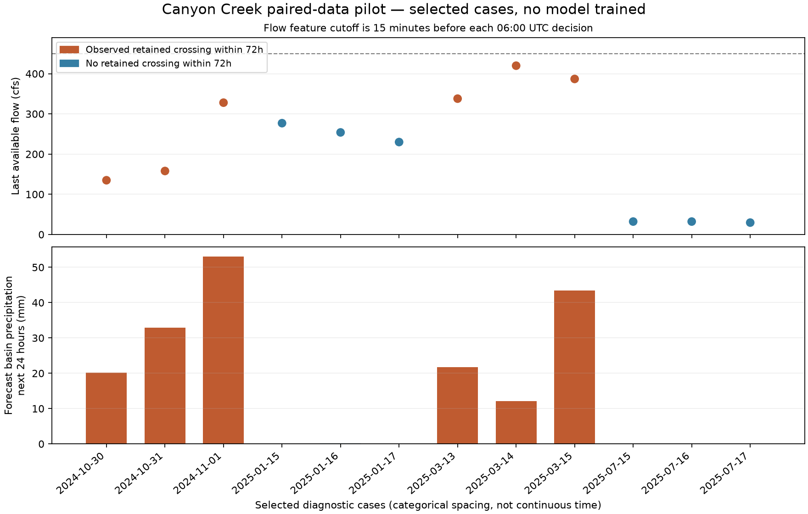

# Canyon Creek 2025 paired-data pilot

Follow-up: the [full water-year 2025 build](dataset_2025.md) is complete with 258 paired
daily rows. The results below describe the original twelve-row pilot.

**Completed: 12 paired rows, six crossing cases and six controls, with 18 predictor columns.**
Actual archived operational NDFD forecasts were spatially averaged over the repository's Canyon
Creek boundary and joined to antecedent USGS discharge and the agreed 72-hour crossing target.
No model was fitted. The pipeline passes mechanical timing, quality and consistency checks under
explicit source-availability assumptions; actual historic delivery times are not independently verified.

## Data files

All small exports are under [`data/pilot_2025/`](../data/pilot_2025/):

| File | Role |
| --- | --- |
| `features.csv` | 12 rows; numeric predictor allowlist plus neutral case IDs and decision times |
| `labels.csv` | Crossing outcome, target end, first crossing and lead time; kept separate from predictors |
| `provenance.csv` | Original issue key/URL/hash, source clocks, observation cutoff and coverage |
| `qpf_intervals.csv` | 144 basin-average six-hour interval records, including the elapsed interval for audit |
| `manifest.json` | Policy, case status, column roles, data/code/config hashes and package versions |
| `cost_checks.json` | Measured transfer/processing checks and byte-identical cache replay result |

The raw GRIB files and validated extraction caches remain in ignored `.cache/`; the exports total
about 52 KB. `configs/pilot_2025.json` declares the twelve cases and timing rules. Window names
and selection reasons are provenance, not predictor columns.

## Selection and results

The sample was deliberately selected for pipeline testing: three decisions around each of two
known crossings, three January controls and three July controls. **Six positive rows represent
only two actual crossing events.** The artificial 50% positive fraction is not event prevalence
and must not be used as an evaluation sample or evidence of forecast skill. Overlapping windows
are correlated.

Every decision is at **06:00 UTC** on the date shown:

| Case | UTC date | Last available flow, cfs | Forecast next 24h basin depth, mm | Crossing within 72h | Observed lead, hours |
| --- | --- | ---: | ---: | ---: | ---: |
| P001 | 2024-10-30 | 135.0 | 20.19 | 1 | 51.75 |
| P002 | 2024-10-31 | 158.0 | 32.90 | 1 | 27.75 |
| P003 | 2024-11-01 | 328.0 | 53.11 | 1 | 3.75 |
| P004 | 2025-01-15 | 277.0 | 0.00 | 0 | — |
| P005 | 2025-01-16 | 254.0 | 0.18 | 0 | — |
| P006 | 2025-01-17 | 230.0 | 0.00 | 0 | — |
| P007 | 2025-03-13 | 338.0 | 21.72 | 1 | 51.50 |
| P008 | 2025-03-14 | 420.0 | 12.18 | 1 | 27.50 |
| P009 | 2025-03-15 | 387.0 | 43.37 | 1 | 3.50 |
| P010 | 2025-07-15 | 32.2 | 0.00 | 0 | — |
| P011 | 2025-07-16 | 32.2 | 0.00 | 0 | — |
| P012 | 2025-07-17 | 29.6 | 0.00 | 0 | — |



The first event is November 1, 2024 at 09:45 UTC; the second is March 15, 2025 at 09:30 UTC.
The table's rain is **forecast** depth over the exact interval `[decision, decision+24h]`, not
realized precipitation or an accumulation beginning before the decision.

## Clock and eligibility contract

| Item | Fixed pilot policy / observed result |
| --- | --- |
| Decision | 06:00 UTC daily; event deduplication still uses Pacific calendar dates |
| Bulletin selection | First canonical CONUS bulletin named within that UTC day's 00:00–01:00 window; sidecars excluded |
| Actual references | 00:30 UTC for all twelve selected issues |
| Assumed forecast availability | `max(filename timestamp, GRIB reference) + 60 minutes`; 01:30 UTC for these issues |
| Maximum issue age | Six hours; observed reference age is 5.5 hours in every row |
| Assumed flow-feed delay | Fifteen minutes; all observed-flow predictors end at 05:45 UTC |
| Antecedent data | Complete approved, unqualified quarter-hour observations over the prior 72h through that cutoff |
| Risk-state checks | Last available flow below 450; actual decision-time flow also below 450 as a retrospective eligibility check |
| Label | First retained upward crossing in `(decision, decision+72h]`, at most one per Pacific date |
| Label quality | Complete approved quarter-hour observations from current local midnight through the target end |

The actual decision-time flow check is exported only as a **label/eligibility audit field**, not a
predictor. Its historical publication time is not verified. This is a selected diagnostic sample;
a future prospective risk-set implementation must use the latest actually available observation
and explicitly address a crossing during the feed-delay interval.

The delays are conservative **assumptions**, not measured receipt times. Approved historical
USGS flow may also include revisions made after the original decision. Therefore timestamp checks
alone do not prove a fully real-time, revision-free hindcast. Before unbiased model evaluation,
validate delivery-latency assumptions and assess using final versus contemporaneous flow values.

## Predictors and precipitation coverage

Flow predictors are the last available discharge; lags 1/6/24/72 hours relative to the observation
cutoff; 6/24/72-hour means; 24-hour maximum; and a six-hour change. Two cyclic day-of-year
variables use the known decision calendar. Weather predictors are basin QPF over the next
6/12/24/48/60 hours and forecast age. The manifest gives the exact 18-column allowlist.

Each source has twelve six-hour bins. At 06Z, the 00–06Z bin has elapsed and is excluded from
future precipitation features. Eleven complete future bins remain, covering **66 hours**.
**A next-72h precipitation total is not created or imputed.** Coverage is recorded explicitly as
66/72 hours while the streamflow target remains 72 hours. No six-hour depth is redistributed
into fictitious hourly rainfall.

All twelve forecasts have approximately 100% valid basin area across **46 fractional-area-weighted
cells**. No point-cell substitution was used. Units are kg/m², equivalent to mm water depth.
All fields were cross-checked against two independent decoders after correcting alternating row
order; the largest discrepancy across this pilot was about **0.00000672 mm**.

## Validation performed

- Source/config/code hashes and output hashes are stored and checked. One-to-one case joins,
  predictor/label separation, finite features, basin coverage and source issue clocks pass.
- The exported flow features, basin-depth aggregations and labels are recomputed from their
  inputs by `scripts/validate_pilot_2025.py`, with no network requests.
- A regression test changes all flow observations after the permitted feature cutoff and confirms
  predictors do not change. Other tests reject late issues, elapsed-bin inclusion, overlapping
  precipitation accumulations, missing/unapproved history and incorrect target endpoints.
- Current-time crossings are excluded from the future target; a crossing exactly at +72h is
  included. A later same-day oscillation is not a new retained event.
- A cached rebuild downloaded zero bytes and reproduced **all four CSV files byte-for-byte**.
- **32 regression tests passed**, including the prior audit/extraction tests and eight new pilot tests.

These are data-pipeline checks, not model accuracy or operational delivery validation.

## Measured volume and runtime

- Initial acquisition: **9 new files / 52,963,405 bytes (50.51 MiB)**; three existing grids reused.
- All twelve unique source files: **69,986,963 bytes (66.74 MiB)**.
- Full decoding/extraction from already downloaded raw grids: **14.90 seconds** for twelve files
  on this cloud machine, including independent decoder comparisons.
- Warm extraction-cache rebuild: **0.28 seconds**, zero new downloads; CSV hashes identical.
- Cold network-transfer time was not separately retained. The measured processing times exclude
  downloading and are not a full-year runtime guarantee.

A simple upper estimate at one selected issue/day is about **2 GiB of raw grids per year** and
several minutes of decoding at the measured speed, before network delays. This is an estimate,
not a full-year download performed here. Screening flow eligibility before fetching forecasts
and retaining derived basin features can reduce future acquisition/storage. Do not silently
expand to every half-hour issue.

## Reproduction

From the repository root, activate the existing cloud environment:

```bash
source /workspace/venvs/watershed/bin/activate
python -B scripts/build_pilot_2025.py --cached-only
python -B scripts/validate_pilot_2025.py
python -B scripts/plot_pilot_2025.py
python -B -m unittest discover -s scripts -p 'test_*.py' -v
```

For first-time construction, omit `--cached-only`; the configuration caps new downloads at
80 MiB and twelve files. The source flow CSV and date inventory come from the completed
water-year audit. On a fresh machine:

```bash
python -m pip install -r requirements.txt
python -B scripts/audit_water_year.py --water-year 2025
python -B scripts/audit_water_year_inventory.py --water-year 2025
bash scripts/setup_grib2io.sh
python -B scripts/build_pilot_2025.py
python -B scripts/validate_pilot_2025.py
```

The native helper needs Git/CMake/a C compiler and pins the tested g2c source. No USGS download
is needed when the existing annual CSV is available. Forecast requests are anonymous public S3
GETs; no key values are placed in URLs, logs or data artifacts. Pipeline errors mark the manifest
incomplete and return nonzero; no partial run is described as a complete dataset.

## Conclusion and next boundary

The pilot demonstrates a reproducible join of archived operational forecasts, area-weighted
basin precipitation, past flow and the selected crossing target. The next expansion would be a
budgeted full-year paired dataset, using the same explicit quality/clock checks and a prospective
sampling rule rather than these retrospectively chosen cases. Keep historical receipt/revision
uncertainty and incomplete 72h QPF coverage explicit. **No predictive model has been trained.**
